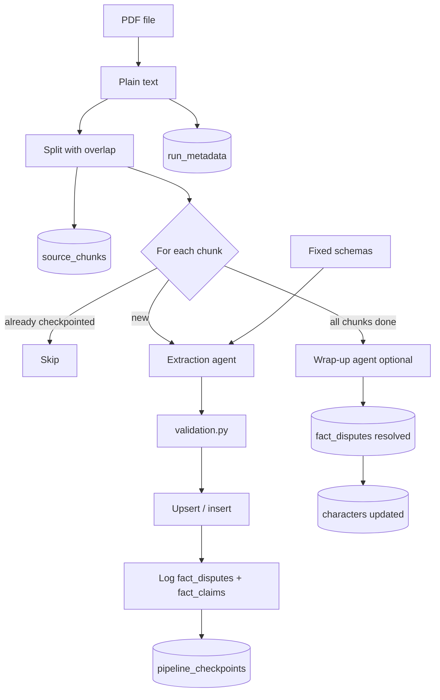

# PDF → Structured extraction → DuckDB

Turn narrative PDFs into a queryable DuckDB database using **one extraction agent per chunk** and a **fixed schema**. The LLM returns structured JSON; Python owns chunking, validation, conflict logging, database writes, and optional dispute reconciliation.

## What it does

1. Reads plain text from a PDF
2. Splits long books into **overlapping word chunks** (default 3,000 words, 400 overlap)
3. Stores **verbatim chunk text** in `source_chunks` (Python, not the LLM)
4. Runs a **Pydantic AI** extraction agent once per chunk (structured output, no tools)
5. **Validates** rows in Python before any write
6. **Upserts** characters, spells, and houses; **appends** house point events
7. **Logs disputes** when a chunk tries to change an already-set character field
8. **Checkpoints** each successful chunk so `--resume` can continue after crashes
9. **Wrap-up agent** (optional, stronger model) reconciles open disputes using source chunk text

## How it works

This is a **batch ETL pipeline**, not a tool-using agent loop.



### The agent does not write to the database

The extraction agent has **no tools** and **no SQL access**. Pydantic AI forces it to return JSON matching `ChunkExtractionResult`:

```json
{
  "rows": [{"values": {"character_name": "Harry Potter", "house": "Gryffindor", ...}}],
  "spell_rows": [...],
  "house_rows": [...],
  "point_event_rows": [...],
  "notes": ""
}
```

Python then:

1. Parses JSON into Pydantic objects (`ExtractedRow`, etc.)
2. Converts to plain dicts (`rows_from_extraction`)
3. Validates and drops bad rows (`validation.py`)
4. Merges with existing DB rows and executes SQL (`database.py`)
5. Logs scalar conflicts as disputes (`conflicts.py`)
6. Checkpoints the chunk (`checkpoints.py`)

The LLM **proposes** facts; Python **decides** what lands in DuckDB.

### Per chunk

1. Build prompt: user request + column descriptions + known entity names + chunk text
2. Agent returns `ChunkExtractionResult`
3. Validate and drop unsupported rows
4. Upsert characters / spells / houses; append point events
5. Log scalar conflicts on character fields
6. Sync house rosters from student characters
7. Checkpoint on success

### If a chunk fails

After `--max-retries` (default 3), the chunk is **skipped** (not checkpointed). The run continues. Re-run with **`--resume`** to retry only failed chunks.

### After all chunks

If `OPENROUTER_WRAPUP_MODEL` is set and open disputes exist, the wrap-up agent reads each dispute’s claim timeline plus **source chunk text**, picks a canonical value, and updates `characters`. Use **`--skip-wrap-up`** to leave disputes open for manual review.

## Design

| Layer | Responsibility |
|-------|----------------|
| `schemas.py` | Fixed table definitions (`DatabasePlan`) and agent output shape |
| `agents.py` | System prompt, per-chunk prompt, API retries and timeouts |
| `validation.py` | Drop bad rows before upsert |
| `database.py` | Create tables, merge/upsert, insert point events |
| `conflicts.py` | Disputes, claims, source chunks, run metadata |
| `checkpoints.py` | Resume support (`pipeline_checkpoints`) |
| `wrapup.py` | One-shot dispute reconciliation |
| `inspect/` | CLI to list, show, export, and manually resolve disputes |
| `pipeline.py` | Orchestrates the full flow |

Each `DatabasePlan` has a `reasoning` field printed at startup for humans only; it is **not** sent to the LLM. Column `description` strings **are** injected into every chunk prompt.

## Project layout

```
agentic-project/
├── main.py              # CLI entry point
├── requirements.txt
├── .env.example         # Copy to .env and add your API key
├── data/                # Input PDFs (not committed; see data/README.md)
├── output/              # Generated DuckDB files (not committed)
└── src/
    ├── config.py        # API key, model, chunk defaults
    ├── pdf_reader.py    # PDF → plain text (PyMuPDF)
    ├── chunker.py       # Word-based chunks with overlap
    ├── schemas.py       # Fixed table plans + ChunkExtractionResult
    ├── agents.py        # Extraction agent + retry/timeout logic
    ├── validation.py    # Pre-upsert row validation
    ├── checkpoints.py   # Resume checkpoints
    ├── conflicts.py     # Disputes, claims, source chunks
    ├── inspect/         # Dispute inspection CLI
    ├── wrapup.py        # Wrap-up agent (OPENROUTER_WRAPUP_MODEL)
    ├── database.py      # DuckDB create, upsert, point-event insert
    └── pipeline.py      # Wires everything together
```

## Setup

```powershell
cd agentic-project
python -m venv .venv
.venv\Scripts\activate
pip install -r requirements.txt
copy .env.example .env
```

Edit `.env`:

| Variable | Purpose |
|----------|---------|
| `OPENROUTER_API_KEY` | From https://openrouter.ai/keys |
| `OPENROUTER_MODEL` | Extraction model — must exist on OpenRouter |
| `OPENROUTER_TEMPERATURE` | Default `0.1` (low = more deterministic) |
| `OPENROUTER_WRAPUP_MODEL` | Stronger model for dispute wrap-up (optional) |
| `OPENROUTER_WRAPUP_TEMPERATURE` | Wrap-up temperature (default `0.1`) |

**Model tips:** Use a model that supports **structured JSON output** reliably. Pick a current model from https://openrouter.ai/models. An invalid model ID fails immediately with HTTP 404 (not retried).

## Run

Place a PDF in `data/`, then:

```powershell
python main.py ^
  --pdf data\your-book.pdf ^
  --request "Extract human characters, named spells spoken in the text, Hogwarts house facts, and house point events" ^
  --output output\extracted.db
```

**Resume a long run:**

```powershell
python main.py ^
  --pdf data\your-book.pdf ^
  --request "Extract human characters, named spells spoken in the text, Hogwarts house facts, and house point events" ^
  --output output\extracted.db ^
  --resume
```

### CLI flags

| Flag | Default | Meaning |
|------|---------|---------|
| `--output` | `output/extracted.db` | DuckDB output path |
| `--chunk-size` | `3000` | Words per LLM call |
| `--chunk-overlap` | `400` | Overlapping words between chunks |
| `--resume` | off | Skip chunks in `pipeline_checkpoints` |
| `--max-retries` | `3` | Retry transient API errors per chunk (exponential backoff) |
| `--skip-wrap-up` | off | Skip final dispute reconciliation |

For ~1M words with defaults you get roughly **430 chunks** — one API call each.

**Resume:** Re-run with the same `--pdf`, `--output`, `--chunk-size`, and `--chunk-overlap`, plus **`--resume`**.

**Important:** Run only **one** `python main.py` process per `--output` database. A second process will fail with a DuckDB file-lock error.

## Fact disputes and review

When a chunk tries to change an already-set scalar on a character (`house`, `blood_status`, `role_type`, `occupation`), Python logs a **claim** on a **dispute**. All chunk text lives in **`source_chunks`** so you can read the source passage later.

```powershell
# Open disputes only (default)
python -m src.inspect --db output\extracted.db list

# All disputes including wrap-up / manual resolutions
python -m src.inspect --db output\extracted.db list --all

# One dispute with claim timeline and source text
python -m src.inspect --db output\extracted.db show --entity "Harry Potter" --field blood_status

# Export to CSV
python -m src.inspect --db output\extracted.db export --csv output\disputes.csv --all

# Manually resolve an open dispute
python -m src.inspect --db output\extracted.db resolve --entity "Harry Potter" --field house --value Gryffindor --reason "Manual review"
```

After wrap-up, disputes show `status=resolved_wrapup`. Use **`list --all`** to see them; plain **`list`** shows only open disputes.

### Schema tables

| Table | Purpose |
|-------|---------|
| `run_metadata` | PDF path and chunk settings for this run |
| `source_chunks` | Full chunk text (verbatim from PDF) |
| `pipeline_checkpoints` | Chunk indices successfully processed (for `--resume`) |
| `fact_disputes` | One row per entity+field; status `open`, `resolved_manual`, or `resolved_wrapup` |
| `fact_claims` | Timeline of conflicting claims; join `source_chunks` on `chunk_index` for text |

## Database tables

### `characters`

| Column | Meaning |
|--------|---------|
| `character_name` | Full name (unique key) |
| `blood_status` | `muggle`, `half_blood`, or `wizard` |
| `house` | Gryffindor, Hufflepuff, Ravenclaw, Slytherin, or null |
| `role_type` | `student` or `faculty` at Hogwarts, or null |
| `classes_attended` | Comma-separated classes (students only) |
| `occupation` | Job or subject taught if mentioned |
| `character_description` | Short prose personality / character note |

Humans only — no house-elves, ghosts, animals, etc.

### `spells`

| Column | Meaning |
|--------|---------|
| `spell_name` | Exact incantation spoken in the text (unique key) |
| `effect_description` | What the spell does in this passage |
| `used_by` | Who speaks or casts it |

Incantations must appear literally in the chunk text.

### `houses`

| Column | Meaning |
|--------|---------|
| `house_name` | One of the four Hogwarts houses (unique key) |
| `current_students` | Comma-separated current students |
| `prior_students` | Comma-separated alumni / former students |
| `others_not_in_house` | Named humans explicitly not in this house |
| `lore_facts` | Traits, common room, decorations, etc. — **not** point events |

Seeded with four empty house rows on create. `current_students` is also merged from the `characters` table.

### `house_point_events`

| Column | Meaning |
|--------|---------|
| `event_id` | Auto-assigned (append-only) |
| `house_name` | House that gained or lost points |
| `points` | Positive = awarded, negative = deducted |
| `caused_by_student` | Student who caused it, if stated |
| `reason` | Why points changed |

## Validation

Before upserting, `validation.py` drops rows that fail hard rules, including:

- Missing names or invalid enum values
- Non-human characters on a blocklist
- Characters / spell incantations not found in the chunk text
- Point events with zero or missing `points` / `reason`

Validation is not ground-truth checking — use manual review and the dispute tools for accuracy.

## Inspect raw data

```powershell
python -c "import duckdb; c=duckdb.connect('output/extracted.db'); print(c.sql('SHOW TABLES').fetchall()); print(c.sql('SELECT * FROM characters LIMIT 5').fetchdf())"
```

## HTTP API (local)

Run the same pipeline over HTTP with a background job per upload:

```powershell
pip install -r requirements.txt
uvicorn api.main:app --reload --host 127.0.0.1 --port 8000
```

Open **http://127.0.0.1:8000/docs** to try endpoints in the browser.

### Endpoints

| Method | Path | Purpose |
|--------|------|---------|
| `GET` | `/health` | Liveness check |
| `POST` | `/jobs` | Upload PDF + extraction request → `job_id` |
| `GET` | `/jobs/{job_id}` | Job status (`queued`, `running`, `completed`, `failed`) |
| `GET` | `/jobs/{job_id}/db` | Download DuckDB when completed |

Each job writes files under `output/jobs/{job_id}/` (`input.pdf`, `extracted.db`, `meta.json`).

### Example (PowerShell)

```powershell
# Start a job (use a small PDF first)
curl.exe -X POST http://127.0.0.1:8000/jobs `
  -F "pdf=@data/gold/gold-scene.pdf" `
  -F "request=Extract human characters, named spells spoken in the text, Hogwarts house facts, and house point events"

# Poll status (replace JOB_ID)
curl.exe http://127.0.0.1:8000/jobs/JOB_ID

# Download database when status is completed
curl.exe -O -J http://127.0.0.1:8000/jobs/JOB_ID/db
```

Requires the same `.env` as the CLI (`OPENROUTER_API_KEY`, etc.). Long books still take many minutes — poll `/jobs/{job_id}` until `completed`.

### Reading failures in Swagger

When `status` is **`failed`**, **GET /jobs/{job_id}** includes structured fields (also saved in `meta.json`):

| Field | Use it to… |
|-------|------------|
| **`error_code`** | Stable id, e.g. `missing_api_key`, `openrouter_unauthorized`, `upstream_error` |
| **`error_category`** | Bucket: `configuration`, `auth`, `billing`, `provider`, `network`, … |
| **`hint`** | Suggested fix in plain English |
| **`retryable`** | `true` = safe to retry; `false` = fix config/key first |
| **`phase`** | Where it died: `startup`, `database_setup`, `chunk_extraction`, … |
| **`http_status`** | OpenRouter HTTP code when applicable (401, 402, 502, …) |

**POST /jobs** rejects bad config immediately (**400**) with the same shape if e.g. `OPENROUTER_API_KEY` is missing — before a job is created.

Leave **`resume` unchecked** for new jobs. The resume/checkpoint false-positive on seeded house rows is fixed in `src/checkpoints.py`.

## Docker

Run the HTTP API in a container (same endpoints as local uvicorn). Requires [Docker Desktop](https://www.docker.com/products/docker-desktop/).

1. Copy `.env.example` to `.env` and add your OpenRouter key (never commit `.env`).
2. From the project root:

```powershell
docker compose up --build
```

3. Open **http://127.0.0.1:8000/docs** — upload a PDF via **POST /jobs**, poll **GET /jobs/{job_id}**.

Job files are stored in a Docker volume (`job-data` → `/data/jobs` inside the container), not in your local `output/jobs/` folder.

```powershell
# Detached (background)
docker compose up -d --build
docker compose logs -f

# Stop
docker compose down
```

If port 8000 is busy on the host, change `ports` in `docker-compose.yml` to e.g. `"8001:8000"` and use http://127.0.0.1:8001/docs.

**Without Compose** (build + run):

```powershell
docker build -t agentic-extraction .
docker run --rm -p 8000:8000 --env-file .env -e API_JOBS_DIR=/data/jobs -v agentic-jobs:/data/jobs agentic-extraction
```

The image runs **uvicorn** only. For CLI extraction inside the container, mount your PDF and override the command, or use the API upload.

## Cost and runtime

Long books mean hundreds of **sequential** API calls. Runtime depends heavily on model speed:

- **Short PDF**: seconds to a few minutes
- **Full ~1M-word book**: roughly **20–60 minutes** on a fast flash model; slower or flaky models can take much longer

Start with a small PDF before running a full book.

## Things to experiment with

- Edit the system prompt in `src/agents.py`
- Add columns or tables in `src/schemas.py`
- Tune `--chunk-size` / `--chunk-overlap`
- Swap models in `.env`; use a stronger `OPENROUTER_WRAPUP_MODEL`
- Tighten or relax rules in `src/validation.py`
- Run with `--skip-wrap-up` and resolve disputes manually via `src.inspect`

## Security

- **Never commit `.env`** — it contains your API key (already in `.gitignore`)
- Copy `.env.example` to `.env` and add your own key
- If a key was ever committed or shared, **rotate it** at https://openrouter.ai/keys
