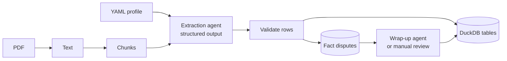

# pdf2duckdb

[](https://github.com/bluecatyellowdog/agentic-extraction-prototype/actions/workflows/ci.yml)

Turn long PDFs (books, reports, transcripts) into a queryable **DuckDB** database. You describe the tables you want in a small YAML **profile**. An LLM extracts rows chunk by chunk, and Python validates and merges them, tracking any contradictions it finds along the way.

```bash
pdf2duckdb extract --pdf examples/a-scandal-in-bohemia.pdf --profile novel --output output/bohemia.db
duckdb output/bohemia.db "SELECT name, occupation, relationships FROM characters"
```

## Why it's built this way

- **The LLM proposes, Python decides.** The model has no tools and no database access. It returns structured JSON against a schema generated from the profile. Python validates every row before writing: required fields, closed value sets, and whether a name actually appears in the source text.
- **Built for long documents.** Text is split into overlapping chunks. Each chunk is checkpointed, so a crashed or rate-limited run continues with `--resume` instead of starting over.
- **Contradictions are kept, not overwritten.** When a later chunk disagrees with an earlier one (say, a character's occupation), both claims are logged with their source passages. An optional stronger "wrap-up" model reconciles them at the end, or you can resolve them yourself from the CLI.
- **Domain-agnostic.** Tables, columns and rules live in YAML, so the same pipeline handles novels, meeting minutes or annual reports.



## Quick start

Requires Python 3.11+ and an [OpenRouter](https://openrouter.ai/keys) API key.

```bash
git clone https://github.com/bluecatyellowdog/agentic-extraction-prototype.git
cd agentic-extraction-prototype
python -m venv .venv
source .venv/bin/activate        # Windows: .venv\Scripts\activate
pip install -e .
cp .env.example .env             # then add your OPENROUTER_API_KEY
```

Run the bundled sample: *A Scandal in Bohemia*, ~8.5k words, public domain.

```bash
pdf2duckdb extract --pdf examples/a-scandal-in-bohemia.pdf --profile novel --output output/bohemia.db
```

Then query the result with the DuckDB CLI, Python, or any DuckDB client:

```sql
SELECT name, aliases, occupation FROM characters ORDER BY name;
SELECT chunk_index, summary, participants FROM events ORDER BY id;
SELECT * FROM fact_disputes;
```

## Profiles

A profile declares the tables to build. This is a trimmed version of the built-in [`novel`](src/pdf2duckdb/profiles/novel.yaml) profile:

```yaml
name: novel
description: People, places, organisations and key events in a work of narrative fiction.
tables:
  - name: characters
    key: name                     # rows with the same key are merged across chunks
    description: One row per named person.
    columns:
      - name: name
        description: Full canonical name.
        grounding: any_token      # drop rows whose name is not in the chunk text
      - name: occupation
        description: Job or social position.
        track_conflicts: true     # log a dispute if a later chunk disagrees
      - name: aliases
        description: Other names or titles.
        merge: append             # accumulate values instead of overwriting
  - name: events                  # no key: append-only log with id + chunk_index
    description: One row per significant plot event.
    columns:
      - name: summary
        description: What happens.
        required: true
```

Use `pdf2duckdb profiles` to list the built-in profiles, or pass a path to your own: `--profile my_profile.yaml`. [`examples/profiles/wizarding_world.yaml`](examples/profiles/wizarding_world.yaml) shows closed value sets, seeded rows, blocklists and integer columns. The full field reference is in [docs/profiles.md](docs/profiles.md).

## Reviewing disputes

```bash
pdf2duckdb disputes --db output/bohemia.db list
pdf2duckdb disputes --db output/bohemia.db show --entity "Irene Adler" --field occupation
pdf2duckdb disputes --db output/bohemia.db resolve --entity "Irene Adler" --field occupation \
    --value "opera singer" --reason "Stated directly in chunk 2"
pdf2duckdb disputes --db output/bohemia.db export --csv output/disputes.csv --all
```

Set `OPENROUTER_WRAPUP_MODEL` to have a stronger model resolve open disputes automatically at the end of a run. Pass `--skip-wrap-up` to leave them open for manual review.

## CLI reference

| Flag | Default | Meaning |
|------|---------|---------|
| `--pdf` | required | Input PDF |
| `--profile` | `novel` | Built-in profile name or path to a `.yaml` profile |
| `--output` | `output/extracted.db` | DuckDB file to write |
| `--request` | none | Extra guidance added to every chunk prompt |
| `--chunk-size` / `--chunk-overlap` | `3000` / `400` | Words per chunk and overlap between chunks |
| `--resume` | off | Keep the database and skip chunks that are already checkpointed |
| `--max-retries` | `3` | Attempts per chunk on transient API errors |
| `--skip-wrap-up` | off | Don't run the dispute wrap-up model |

Configuration comes from environment variables (see [`.env.example`](.env.example)): `OPENROUTER_API_KEY`, `OPENROUTER_MODEL`, `OPENROUTER_TEMPERATURE`, `OPENROUTER_WRAPUP_MODEL` and `OPENROUTER_WRAPUP_TEMPERATURE`.

Each chunk is one API call, so cost and runtime scale with document length. A 100k-word book with the default chunking is about 40 calls. Try a short document first.

## HTTP API and Docker

```bash
pip install -e ".[api]"
uvicorn pdf2duckdb.api.main:app --reload     # or: docker compose up --build
```

Upload a PDF to `POST /jobs`, poll `GET /jobs/{id}`, and download the database from `GET /jobs/{id}/db`. Interactive docs are served at http://127.0.0.1:8000/docs. See [docs/api.md](docs/api.md) for endpoints, error codes and Docker details.

## Output tables

Besides the profile's own tables, every database contains:

| Table | Purpose |
|-------|---------|
| `source_chunks` | Verbatim text of every chunk, so any fact can be traced to its passage |
| `fact_disputes` / `fact_claims` | Contradictions on `track_conflicts` columns and the timeline of claims |
| `pipeline_checkpoints` | Chunks completed per run, used by `--resume` |
| `run_metadata` | PDF path, profile and chunk settings |

## Development

```bash
pip install -e ".[api,dev]"
pytest          # runs offline: the pipeline tests use a fake model
ruff check . && ruff format --check .
```

```
src/pdf2duckdb/
├── profile.py        # Profile models and loading
├── profiles/         # Built-in profiles (YAML)
├── schemas.py        # Agent output models generated from a profile
├── agents.py         # Prompt rendering, OpenRouter model, retries and timeouts
├── validation.py     # Profile-driven row validation
├── database.py       # Table creation, merge/upsert, append-only inserts
├── disputes.py       # Source chunks, disputes and claims
├── checkpoints.py    # Resume support
├── wrapup.py         # Dispute reconciliation agent
├── pipeline.py       # Orchestration
├── cli.py            # `pdf2duckdb` command
└── api/              # FastAPI job server
```

## License

[MIT](LICENSE). The sample PDF in `examples/` is a public-domain text from [Project Gutenberg](https://www.gutenberg.org/ebooks/1661).
